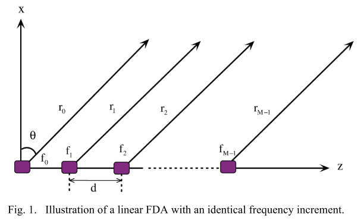
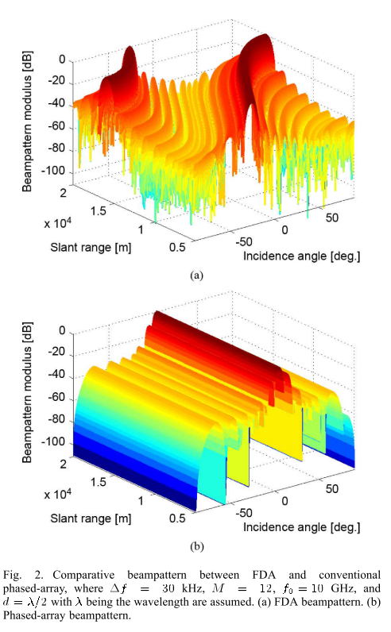
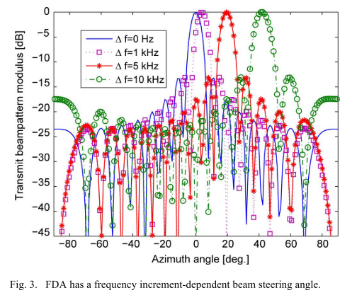
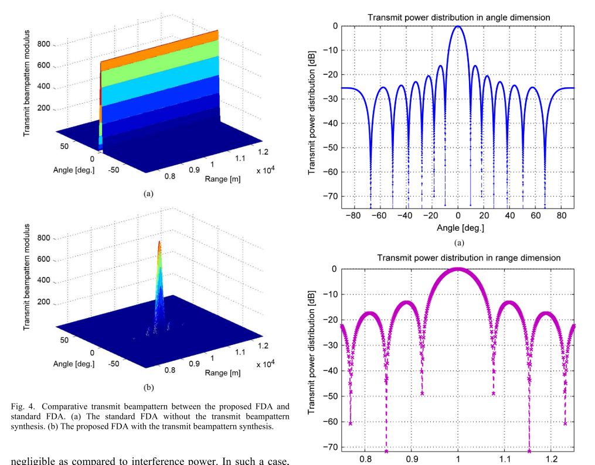
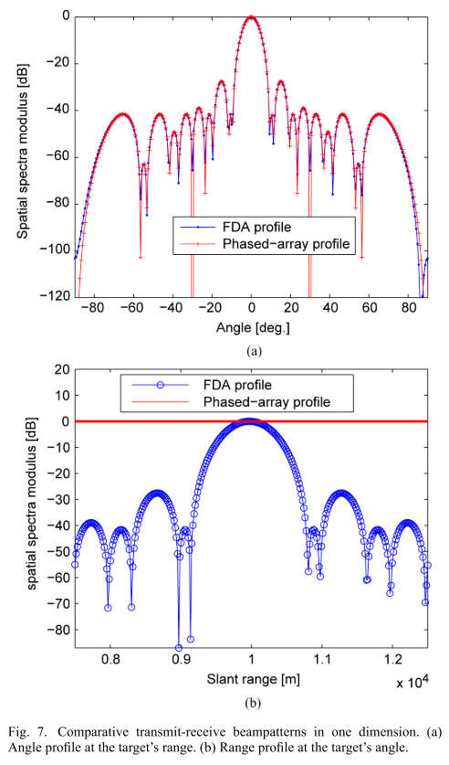
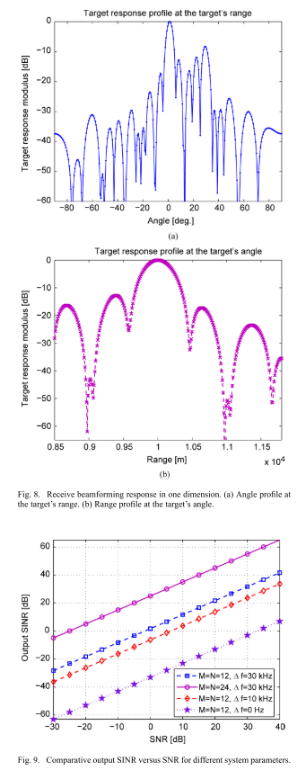
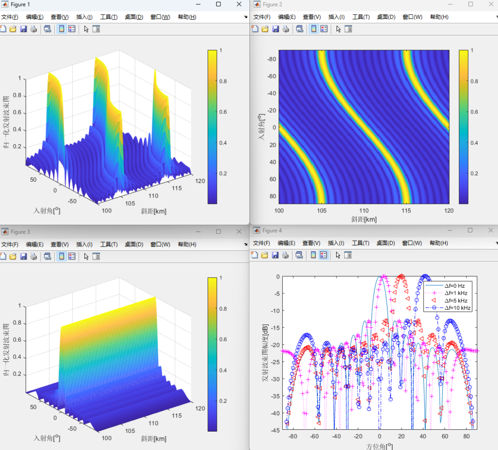

# Frequency-controlled Array Radar: Integrated Beam Pattern of Linear Frequency Diversity Based on Distance-Angle Relations [With MATLAB Code]

Introduction\tPhased arrays are widely used in many modern communication, radar, and navigation systems [1]-[5]. Phased arrays provide directional gain, which is very useful for detecting/tracking weak targets in the line of sight of a radar while suppressing strong sidelobe interference from other directions. However, phased arrays have a limitation; their beam steering is fixed at a certain angle across all ranges. This limits their ability to mitigate undesired range-dependent interference, thereby reducing their capability to identify range-dependent targets. Additionally, if we want to concentrate transmit power on directions with different ranges [6]-[8], multiple antennas or multibeam antennas should be employed.
Recently, a flexible beam scanning array known as the Frequency Division Multiplexing Array (FDA) was introduced in [9]-[13]. Note that the FDA discussed herein is distinct from general MIMO arrays [14]-[17], which employ orthogonal waveforms in each MIMO antenna. The most significant difference between the FDA and traditional phased array antennas lies in the use of a small frequency increment between elements. It has been recognized in [9] that the apparent beam steering angle of the FDA can be outside its actual beam space. This provides greater freedom for system designers and subsequent additional capabilities. In [18], it was proposed that the FDA formed through utilizing degrees of freedom including spatial, temporal, frequency, and modulation could simultaneously provide multiple tasks. Two patents on FDA radar have been published [19], [20], where the increased degrees of freedom were discussed. A simulation of continuous FDA beam scanning characteristics was presented in [21]. From a simulation perspective, the FDA was studied in [22], and a low-cost FDA design was proposed. Other studies were presented in [23]-[25] to utilize range-dependent and periodic FDA beam pattern characteristics. Specifically, Higgins and Blunt [25] explored the distance and angle coupling beam forming with linearly time-varying signals having different frequencies. The authors of [25] also studied waveform ambiguity plots in a manner similar to traditional MIMO arrays. The benefits of applying the FDA to high-resolution radar imaging are discussed in [26]-[28].
The FDA has recently received considerable attention, yet the majority of published work has focused on analyzing wavefront characteristics related to distance. An unresolved issue is how to precisely manipulate the beam direction within the desired range, as the beam pattern couples in both range and angle response. The apparent scanning angle of the FDA does not equal the nominal scanning angle, meaning that precise beam steering depends on range and angle parameters. Therefore, it is insufficient to control the beam like traditional phase-controlled array antennas; however, the FDA provides new degrees of freedom for the design and control of antenna beam patterns in terms of range, angle, and time. This offers the possibility of beam scanning without the need for phase shifters or mechanical manipulation. It also provides a potential design for distance-angle-related transmit beam patterns. In [29], a penalty function based on quasi-continuous waveform (QCW) was proposed and optimized through genetic algorithms, aimed at reducing dynamic range. The authors only considered waveform optimization and distance-dimensional signal processing, but the FDA requires two-dimensional processing.
In this paper, I propose a linear FDA-based beamforming synthesis scheme for wavefronts related to distance angles, aiming to concentrate the transmission energy in the desired two-dimensional spatial sector. Beamforming synthesis is widely used in array processing to provide various performance improvements, such as reduced computational burden [30], enhanced beamforming performance [31]-[33], and improved direction of arrival (DOA) estimation performance [34], [35]. However, the main drawback of most traditional beamspace design techniques is that they essentially ignore interference outside the desired beamspace sector. Therefore, the current beam pattern synthesis techniques may not be robust enough for some applications due to the lack of robustness against sector-outside interference. In the given two-dimensional beam angle sector case, the proposed beam directional synthesis method in this paper has good robustness against sector-outside interference, especially distance-related interference. The beamspace synthesis matrix is designed as a matrix filter satisfying a certain compromise between requirements within and outside the sector. On this basis, the analysis of the distance-angle-related beamforming performance is conducted, and a distance-angle-related beamforming algorithm is derived.
Conclusion: In recent years, the FDA has received widespread attention, but research on distance-angle-correlated beamforming and its applications is still limited. This paper proposes a method for synthesizing distance-angle-correlated beam directional patterns, which linearly combines distance-angle-correlated beam directional patterns using FDA. The proposed method allows FDA to focus the transmitted energy at desired distance or angle segments. This provides a potential solution for suppressing distance-angle-correlated clutter and interference, which is not feasible for traditional phased arrays. A FDA signal model was established, and a distance-angle-correlated beam synthesis scheme was proposed. The performance of beamforming was verified through analysis of the transmit-receive beam diagrams and output SINR gains. Numerical simulation examples were conducted extensively. Simulation results show that the SINR performance of this array is superior to that of traditional phased arrays. More importantly, FDA provides a distance-angle-correlated beam directional pattern that can be used to suppress distance-angle-correlated interference, especially distance-related interference that cannot be achieved by traditional phased arrays. It should be noted that due to our primary consideration of the synthesis of the transmit beam directional pattern, and the frequency increment being much smaller than the carrier frequency (), we have omitted Doppler effects in this paper. However, we recognize that further research will be needed when Doppler effects cannot be ignored. Another follow-up work is to develop adaptive beamforming algorithms for FDA, as this paper only considers non-adaptive beamforming algorithms.
MATLAB Simulation Results

## Images

<!-- PAYMENT_BLOCK -->

## Get this dataset

- Payment link (Stripe): [Buy now](https://buy.stripe.com/3cs8yP7sY87d0vu9AB)
- Payment QR code: 

<!-- /PAYMENT_BLOCK -->
